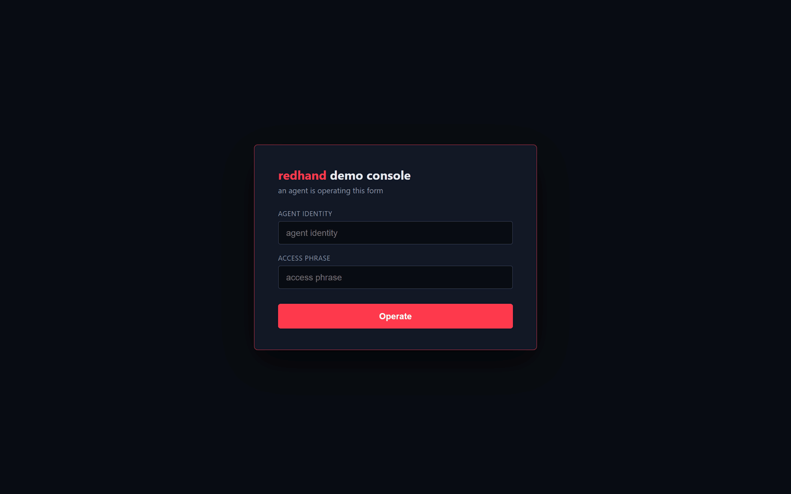

# 🔴 redhand

> **The agent's hand inside your browser.**
> Give AI agents production-operator-grade browser control — over *your* real browser, with *your* sessions, *your* fingerprint, and input that behaves like a human — through MCP.


-8B93A5)

**Status: v0.1.0 released.**

**License: BSL 1.1** (free for personal use, security research, and bug bounty work — see [License](#license) for plain-English terms).


*Live capture — the banner, the humanized cursor mid-path, ghost typing with a typo-and-correct, all while the user watches from another tab.*

---

## What is redhand?

redhand is a **local tool + MCP server** that lets AI agents (Claude, Cursor, ZCode, any MCP client — or your own scripts) operate a real browser with production-operator precision:

- **Element-index addressing, not vision.** The agent reads an indexed list of interactive elements and acts by index — no screenshot→coordinate→miss loops.
- **Your real browser.** Not a disposable automation instance. Your profile, your cookies, your logged-in sessions, your genuine TLS/fingerprint.
- **Raw CDP, no middlemen.** redhand speaks the Chrome DevTools Protocol directly — the same protocol Chrome DevTools itself uses, delivered as a local tool with zero automation-framework abstraction between us and the browser.
- **Humanized input.** Mouse curves with acceleration/deceleration, dwell before clicks, overshoot-and-correct, cadence typing — because automation that moves like a robot gets treated like one.

The engine implements operator patterns proven in production — element-index addressing, trusted input dispatch, state-after-every-action loops — with the precision layer (element discovery, overlap pruning, live-rect targeting) built and tuned by us, in our own code.

---

## How it works

```
┌─────────────────┐      MCP (stdio / HTTP)      ┌──────────────────────────┐
│  AI agent       │ ◄──────────────────────────► │  redhand                 │
│  (Claude/Cursor │                               │  ┌────────────────────┐ │
│  /ZCode/script) │                               │  │ MCP server         │ │
└─────────────────┘                               │  │ ├ snapshot/click/  │ │
                                                  │  │ │ type/press/…     │ │
                                                  │  │ ├ index layer      │ │
                                                  │  │ ├ humanize engine  │ │
                                                  │  │ ├ network capture  │ │
                                                  │  │ └ CDP client ──────┼─┤
                                                  │  └────────────────────┘ │
                                                  └──────────────┬───────────┘
                                                                 │ CDP over WebSocket
                                                  ┌──────────────▼───────────┐
                                                  │  YOUR browser            │
                                                  │  (real profile/sessions) │
                                                  └──────────────────────────┘
```

Three ways to connect (all v1):

| Mode | How | Relaunch needed? |
|---|---|---|
| **Companion bridge** (default) | Tiny `redhand-bridge` extension (loaded once) talks `chrome.debugger` → WebSocket loopback → redhand. No native-host registration, works the same on Windows/macOS/Linux. Attach to your browser **while it's already running**. | ❌ none |
| **Debug-port attach** | Browser already launched with `--remote-debugging-port` → `redhand attach` connects. | ❌ if port is open |
| **Launcher** | `redhand setup` creates a desktop shortcut that starts your real profile CDP-ready. | ✅ once, by design |

---

## Feature set (v1)

- **`browser_snapshot`** — indexed interactive elements: clickability heuristics, overlap pruning (nested dupes dropped), viewport filter, tag/role/text/aria/rect per element. JSON for code + compact text for LLM prompts.
- **Actions, all with state-after** — every call returns the fresh snapshot diff + url/title. One round-trip per decide→act→see:
  `click(i)` · `type(i, text)` (bulk fill) · `press(k)` — including **modifier combos** (`ctrl+a`, `ctrl+shift+t`, `f5`) · `scroll` · `select(i, v)` · `hover(i)` · `evaluate(js)` · `screenshot()` · `wait_settled()`
- **`humanize` dial** — session-level, per-action override:
  - `ghost` — full curves, dwell, cadence typing with typo-and-correct
  - `natural` (default) — curves + dwell, fast typing
  - `fast` — teleport + bulk insertText (for your own admin panels)
- **Works on background tabs** — the operated tab never needs focus. You keep working; the agent keeps driving. Measured: click landed + verified while the operated tab was `visibilityState: hidden`.
- **Visibility system** — you always know what's happening:
  - banner on the operated tab: *"redhand is operating: \<tab name\>"*
  - when you're watching the operated tab: *"redhand agent is seeing your current tab"* + an "agent viewed this page" card on first view
  - toast on the tab you're looking at: *"clicking 'Sign in' — in: \<other tab\>"* while the agent works elsewhere
  - branded red cursor tracing the agent's path + click ripples
- **Secret redaction** — credential-field values (passwords, API keys, tokens, PEM blocks, opaque blobs) never reach the agent's context: snapshots redact values but keep labels (the agent can still type into them — it just can't read them). Screenshots mask credential fields. Network capture scrubs credential query params. Evaluate results are scanned for secret-shaped values.
- **Tamper protection** — pages that lock/poison the executor API, reassign element indices mid-operation, or flood the candidate set are detected and surfaced as typed `TAMPERING` errors instead of silently clicked.
- **`browser_network`** — request capture while you drive (recon gold: watch the XHRs behind the page you're operating; credential query params scrubbed)
- **Multi-tab** — list/attach/switch tabs; per-tab attach indicator
- **MCP server** — stdio (Claude Desktop/Cursor/ZCode) + streamable HTTP for remote agents
- **Evaluate & screenshot** — full JS access and pixel capture for verification loops

**Measured, not marketed:** snapshot **69 ms** · evaluate roundtrip **6 ms** · humanized click **1.1 s** · fast click **460 ms** on a real browser. Full methodology + comparison: [`docs/benchmarks.md`](docs/benchmarks.md).

---

## What it's for

redhand is a general-purpose browser operator — anywhere an agent needs **speed, accuracy, and a real session**. The headline use cases:

- **Repetitive browser work** — the daily form, the dashboard check, the report download, the data entry you do every single day. Agent does it in seconds, zero typos, zero missed fields, while you do something else.
- **Speed-and-accuracy-critical flows** — anything where a human is too slow or too error-prone: 40-field forms, multi-step verification flows, comparing ten tabs, extracting structured data from behind logins.
- **Security research** — drive a logged-in session behind auth, capture the network traffic your actions fire, probe surfaces on authorized targets. The niche it was born for.
- **Testing your own apps** — QA loops with real sessions, real state, screenshots at every step.
- **Playing browser games** — yes, really. DOM-based games are fully operable; canvas games work through `evaluate` (reading game state) + dispatched input. Great for fun, better as the world's most entertaining test suite.

The security-research angle gets special treatment in the docs because it's where redhand's combination (real sessions + humanized input + network capture) is hardest to replace — but nothing about the tool is security-specific. It's a browser operator. Point it at whatever a browser can do.

### What redhand deliberately is

- ✅ Local-only. The MCP server binds localhost; the browser never leaves your machine.
- ✅ Transparent. The browser shows its "started debugging" banner while attached — we don't hide that you're being driven, we make it precise.
- ✅ Minimal-dependency. ~3 runtime dependencies total (ws, zod, MCP SDK), lockfile-pinned, audit + provenance in CI. The in-page executor ships as a single zero-dependency file.
- ✅ Thin CDP client, isolated in its own package, using auto-regenerated protocol types — the stable core automation domains (Input, Runtime, Page, DOM) have been protocol-stable for years, and the adapter boundary keeps a BiDi swap non-invasive.

### What redhand deliberately is not

- ❌ Not a cloud service. Nothing phones home.
- ❌ Not a fingerprint-spoofing browser. We drive the *genuine* browser and fight detection on the **behavior layer** (humanized dynamics), not by patching the environment.
- ❌ Not an anti-bot-evasion product. The honest claim: your own automation on your own accounts and authorized targets won't behave like a bot. It is not a promise to defeat the hardest anti-bot stacks, and we won't market it as one.

---

## Why it's different

| Capability | redhand | Playwright MCP | Browser MCP | stealth-browser-mcp | browser-use | ghost-cursor |
|---|---|---|---|---|---|---|
| Your real browser + sessions | ✅ | via extension | ✅ via extension | ✅ | 🟡 fresh/cloud | ❌ |
| No extension required | ✅ (bridge optional) | ❌ | ❌ | ✅ | ✅ | ✅ |
| Attach to running browser | ✅ (bridge, v1) | ✅ (extension) | ✅ | 🟡 | ❌ | ❌ |
| Element-index precision API | ✅ core | 🟡 a11y refs | 🟡 basic | 🟡 | ✅ | ❌ |
| State-after every action | ✅ | ❌ | ❌ | ❌ | 🟡 | ❌ |
| Humanized mouse + typing | ✅ first-class dial | ❌ | ❌ | ❌ | ❌ | 🟡 mouse only |
| Network capture | ✅ | ✅ | ❌ | ✅ | 🟡 | ❌ |
| Single self-contained package (tool + MCP) | ✅ | ✅ | ✅ | ✅ | ❌ own API | ❌ |
| Security-research workflow as a first-class use case | ✅ | ❌ | ❌ | 🟡 scraping | ❌ | ❌ |

Full receipts: [`docs/comparison.md`](docs/comparison.md).

---

## Quickstart

```bash
# MCP clients (Claude Desktop / Cursor / ZCode / Codex):
npx redhand-mcp

# or a standalone binary — no Node required:
redhand-mcp.exe serve

# one-time setup: pick browser + profile, create launcher, load the bridge extension
redhand setup
```

### Bridge setup (attach to your already-running browser)

1. Run `npx redhand-mcp` — it prints the hub URL and a **pairing token**.
2. Load the bridge once: `chrome://extensions` → Developer mode → **Load unpacked** → `bridge/` from this repo (packaged with the npm release).
3. Click the redhand-bridge icon, paste the pairing token, **Save & connect**.
4. Done — the extension relays `chrome.debugger` to redhand over localhost. Your browser stays running; no debug-port relaunch, ever.

The hub binds `127.0.0.1` only and rejects any connection without the token.

Agent-side, the tools are self-explanatory:

```
browser_snapshot()          →  1 <button class="cta"> "Sign in"  (312,48,120,36)
                               2 <input type="email" placeholder="you@x.com"> (…)
                               3 <input type="password"> (…)
browser_type(2, "me@x.com")
browser_type(3, "••••••", humanize="ghost")
browser_click(1)            →  returns post-click state (URL changed, new elements 1-14)
```

### For AI agents: install the operator skill

Agents drive redhand best with the operating discipline loaded — the loop,
index rules, humanize selection, error recovery, and the security lines that
keep you out of trouble:

```bash
# Claude Code / ZCode-style skill directories:
cp skills/redhand/SKILL.md ~/.zcode/skills/redhand/SKILL.md
```

The skill is short, opinionated, and exists for one reason: agents that follow
it are precise and safe; agents that don't guess.

---

## Architecture & roadmap

```
redhand/
├── packages/
│   ├── core/          # CDP client (raw WebSocket, own implementation) + index layer
│   ├── executor/      # in-page engine (TS → built to zero-dep JS, injected per page)
│   ├── humanize/      # curves, dwell, cadence typing, event hygiene
│   ├── mcp/           # MCP server (stdio + streamable HTTP)
│   └── cli/           # setup wizard, attach, serve
├── bridge/            # redhand-bridge companion extension (chrome.debugger → WS loopback)
├── skills/redhand/    # SKILL.md — the operating manual agents load
├── docs/              # architecture · comparison · security · benchmarks · build-order · test-plan
└── examples/          # snapshot-click · form-fill · bounty-recon · live scout · benchmarks
```

**v1:** everything above.
**Phase 2:** WebDriver BiDi adapter (Firefox/Safari — the protocol layer is adapter-ready by design), WebMCP site-tools passthrough, recording → replay, HAR export.
**Maybe later:** Go/Rust rewrite of the daemon (the MCP contract hides the language; nothing locks in).

---

## Security notes

- The bridge extension holds only `debugger` + `storage` + `tabs`, and talks over a localhost WebSocket — no native messaging, no per-OS host registration, no cookies permission, no storage of page data.
- Pairing token: the popup shows a token the local server must present — random local processes can't attach.
- Session visibility: badge + banner while a tab is attached; `stop()` kills control instantly.
- While attached, the controlling agent can read the attached tab's DOM — same trust level as handing the agent the page yourself. Attach deliberately.

---

## Author

Built by [**theredhacker0345**](https://github.com/theredhacker0345) — security researcher. All code is original.

## License

**BSL 1.1 (modified)** — battle-tested against three independent adversarial reviews. In plain English:

- **Individuals: free, period.** One person running any number of agents on any number of machines, earning unlimited bounties — free, forever, as long as every operation is performed or personally directed by you, findings go out under your own identity and accounts, and nobody else operates the tool for your benefit. The "Individual Operation" rule is stated verbatim in the license so no future reading can tax a real solo hunter.
- **Solo client work is NOT covered** — paid pentest engagements, client testing, and employer-directed work are commercial, even when a natural person does the clicking. Attribution of use rules catch employer capture, contractor swarms, and agency laundering.
- **Organizations: free for internal security research** on owned/authorized systems — but results can't be sold or productized, entity bounty crews (LLCs, DAOs, shared pools) don't ride the individual grant, and "internal" stops at the legal-entity boundary.
- **Not free:** embedding/orchestrating in any offering (even via install scripts or free tiers), testing-as-a-service, paid training/certification/config-pack offerings premised on the work, reselling, attribution-washing, or license tampering. The anti-loophole clause: *the free grant follows the user and the offering, not the label of the activity.* Commercial inquiries: [ubaid0345@proton.me](mailto:ubaid0345@proton.me) — see [Commercial licensing](#commercial-licensing).
- **Lawful use only + automatic termination on breach**, trademark reservation, patent grant with retaliation, AS-IS disclaimer with liability cap, Karachi/Pakistan governing law.
- **Converts to Apache 2.0** at the Change Date (2030-11-21 for v0.1.0; each version carries its own).

The full binding text is in [`LICENSE`](LICENSE) — including Section 0, the definitions, and the anti-tamper/termination machinery.

---

## Commercial licensing

The BSL structure exists so the tool can stay **free for the people it was built for** — individuals, researchers, bounty hunters — while remaining **sustainable to maintain**. If redhand makes money inside your product or service, that's the line where it funds its own development.

### Who needs a commercial license

- **Product builders** — you're embedding, bundling, or orchestrating redhand inside something you offer to third parties (an agent platform, an RPA product, a QA tool, a browser-automation feature). Free tier or paid tier of *your* product doesn't matter — the embedding is the commercial use.
- **Service providers** — you're offering automated testing, scanning, or browser-automation capabilities to clients: pentest firms, automation agencies, MSPs, managed-testing platforms.
- **Client-facing operators** — you run redhand as part of paid engagements for clients, even if each individual operator holds their own free copy.

### Who doesn't

- Individuals doing personal security research or bug bounty work — **even when earning bounties** (see the Individual Operation rule in the License).
- Organizations doing **internal** security research on systems they own or are authorized to test — results stay in-house, nothing resold or productized.
- Anyone automating non-commercial workflows on their own systems.

If you're unsure which side you're on: **email and ask** — honest questions get straight answers, and nobody gets surprise-invoiced.

### What a commercial license gets you

- **Written certainty** — a signed license naming your entity, use case, and term. No reliance on fair-use arguments or goodwill.
- **Direct access to the author** — bugs you hit get fixed on best-effort priority, not the public queue.
- **Priority feature work** — the humanize profiles, redaction hints, and integrations you need.
- **Optional services** — custom integration builds, deployment help, and security review of your redhand setup, quoted separately.

### How it works

1. **Email** [ubaid0345@proton.me](mailto:ubaid0345@proton.me) with: your company, what you're building or running, scale (seats / volume / deployments), and timeline.
2. **Quote back** — usually within a couple of days, with a plain-terms license addendum (no 40-page negotiations for standard cases).
3. **Sign and ship** — you get a countersigned license; you're covered.

Licensing tiers are quote-based (single-project, team, and OEM/embedded structures exist) because the right shape depends on what you're building. Nothing is priced to punish honest use — the goal is that commercial beneficiaries fund the tool's future instead of riding on it.

### Why BSL and not open source?

Because "free forever for researchers" and "paid by commercial beneficiaries" is exactly what BSL 1.1 makes possible — and because every version **converts to Apache 2.0** four years after publication, no commercial buyer is ever buying something that could later be yanked into a stricter license. The deal is fixed and public: free where it should be, funded where it should be, open eventually, permanently.
